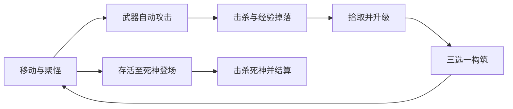
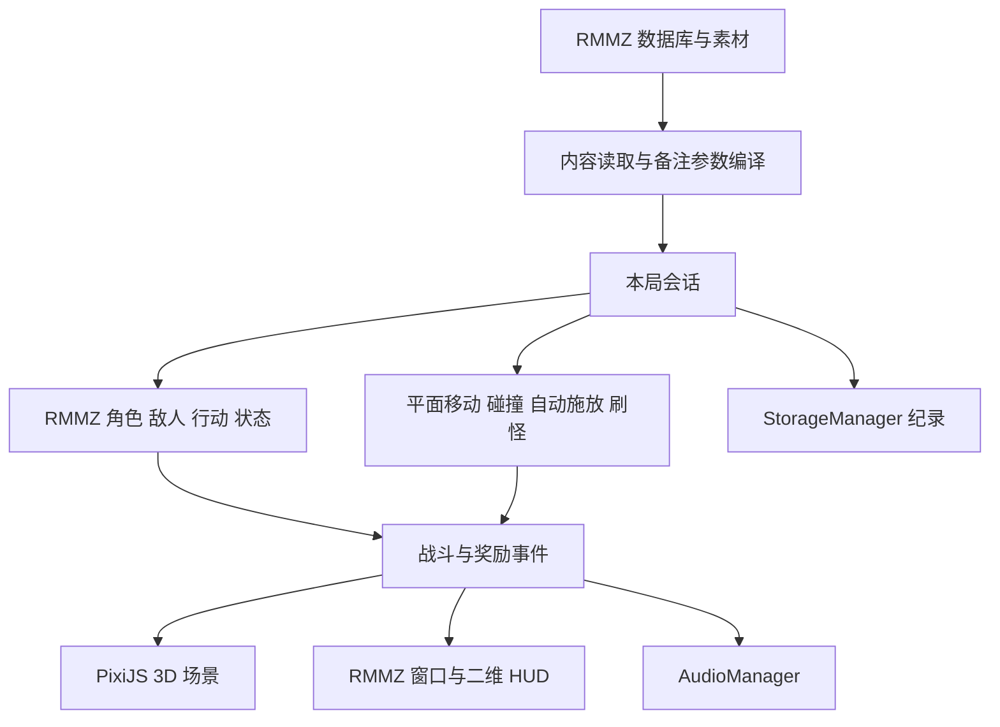
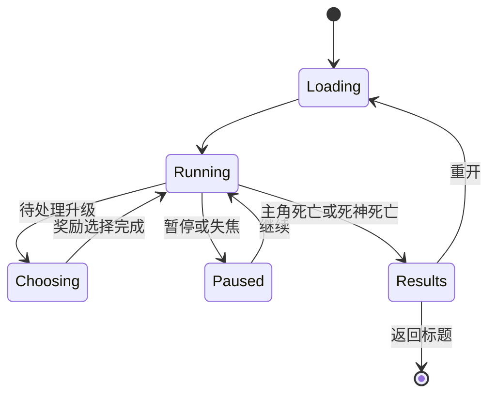

# Nightward 复刻设计与实现方案

> 实现状态：本方案的全量玩法、三维场景、专用标题、菜单、输入、音频和纪录已落到代码与 RMMZ 数据中。按用户约定未执行自动化验证或代理试玩，运行入口见 [工程说明](../README.md)。
>
> 美术、位图字形、UI、墓园几何和音频已改为官方 Nightward 程序生成器的编译产物；运行时不包含原站游戏或引擎发布包。敌群模板的参数实际存于第一页战斗事件注释，便于在 MZ 编辑器中修改。


日期：2026 年 11 月 21 日  
目标工程：`example/nightward`  
技术基础：`rmmz-next`、RMMZ 系统数据、PixiJS 8、`@pixi/3d`

阅读路径：先看第 1、4、5、19 节掌握方案与实施顺序，再按第 6 至 18 节开发，第 20 至 22 节用于交付、用户测试与查阅依据。

## 1 方案结论

采用一个 MZ 插件承载生存玩法：继续使用 RMMZ 编辑器制作角色、技能、敌人、物品、地图和公共事件，继续使用现有游戏对象计算属性、伤害和状态，以专用场景运行连续移动、自动攻击和刷怪，并用 PixiJS 3D 呈现墓园。

完整交付目标是原作的单局闭环：六类自动武器、四类被动、升级三选一、五类普通敌人及精英变体、墓园障碍与补给、死神战、暂停设置和结算纪录。首个可玩版本是实施阶段，不是最终范围。

1. 数据以 RMMZ 为主要内容来源，插件只补充原系统没有的空间、冷却、刷怪和呈现参数。
2. HP、等级、技能、状态和金币继续由 RMMZ 对象持有，避免再维护一套相同数值。
3. 插件采用 ESM，主要逻辑使用 TypeScript；场景、窗口和必要的行为适配沿用引擎继承方式，其余模块使用函数和普通数据结构。
4. 本方案不展开数据库逐字段定义、JSON Schema 或 TypeScript 数据库类型。正文规定数据用途、读取关系、算法和制作清单。
5. 首发运行于当前 WebGL 渲染路径，保留 NW.js 和浏览器两种运行方式。
6. 不增加自动化测试框架、测试用例或代理测试流程。实现完成后提供运行方式，由用户自行测试。

## 2 当前工程与复刻范围

### 2.1 当前工程

| 项目 | 当前状态 | 实施要求 |
| --- | --- | --- |
| 工程启动 | 已使用 `rmmz-next/runtime` 与 Vite | 保留现有入口 |
| PixiJS | 锁定依赖为 8.23.0 | 与 3D 包共用同一实例 |
| 3D 插件 | 先前的标题试验已删除 | 新建完整玩法插件，不恢复旧试验文件 |
| 数据库 | 角色、职业、技能、物品、敌人、敌群等内容已清空，保留一条状态记录 | 按第 5 节重新制作内容；确认死亡状态为 1 号状态 |
| 地图 | 一张 17 × 13 空地图，无事件，关联图块集尚未建立 | 制作专用墓园及有效图块集 |
| 初始队伍 | 空 | 配置一个有效主角 |
| 标题与音频 | 标题为 Nightward，标题背景和 BGM 名称为空 | 制作对应素材并写回系统设置 |
| 插件加载 | 当前只有 `RmmzGlobals` | 在编辑器中登记并启用新插件，保存后试玩 |

### 2.2 完整交付范围

1. 带墓园战斗演示的标题、操作说明、设置、进入新一局。
2. 连续移动、方向控制、场景障碍、受伤反馈、短暂无敌和生命恢复。
3. 六类可并行自动攻击的武器及各自五级成长。
4. 四类被动及各自五级成长。
5. 经验宝石、升级选择、可破坏火盆、补给与宝箱。
6. 随时间增强的敌群、冲锋群、包围圈、精英及死神。
7. 键盘、手柄和触摸移动输入。
8. 像素角色、三维墓园、提灯、阴影、雾和战斗特效。
9. 暂停、局内设置、失败、胜利、重开、返回标题和本地纪录。

## 3 原作系统与复刻基线

以下概述来自[官方范例](https://goodstuff.pixijs.io/nightward/)、[官方介绍](https://pixijs.com/blog/pixi-3d-open-beta)及其[公开发布脚本](https://goodstuff.pixijs.io/nightward/assets/start-DZtWMAL3.js)。后续各节规定本工程的实现方式。

### 3.1 单局循环



玩家控制移动，武器自动施放。经验通过拾取获得；升级时暂停战斗并三选一。死神在 180 秒登场，击杀后胜利，主角死亡则失败。

### 3.2 武器与成长

| 武器 | 行为 | 构筑作用 |
| --- | --- | --- |
| Lash | 朝向附近的挥击，可发展出背向追加攻击 | 开路与近身击退 |
| Wisp Wand | 向附近敌人发射可转向的弹丸 | 远程补刀 |
| Holy Tomes | 书本围绕角色运行，分持续期与休息期 | 环绕保护 |
| Storm Ring | 在范围内选点落雷 | 打击外围敌群 |
| Ward | 角色周围周期性伤害与击退 | 近身清场 |
| Flame Flask | 抛射后生成持续燃烧区域 | 区域控制 |

六种武器及伤害、移速、磁吸、冷却四类被动均有五级。宝石提供不同面额的经验；火盆提供补给；宝箱提供额外升级。每局重置构筑，局外保存纪录和设置。

### 3.3 地图与敌群

墓碑、建筑和补给位置影响移动路线。普通敌群不断增强，周期性穿插冲锋、精英和包围圈。死神具备登场、追击、蓄力、镰刀波与恢复阶段。

### 3.4 呈现方式

原作将像素精灵放入三维场景，配合光照、阴影、雾和后处理。复刻采用相同的二维规则与三维表现组合；角色和普通敌人继续使用像素图。

## 4 总体架构与数据归属



### 4.1 单一数据来源

| 数据 | 权威来源 | 其他模块的使用方式 |
| --- | --- | --- |
| HP、MP、基础属性、特性 | `Game_Actor`、`Game_Enemy` | 读取，不复制出独立 HP 系统 |
| 主角等级与累计经验 | `Game_Actor` | HUD 读取；升级模块记录待选择的等级队列 |
| 已取得的武器等级 | 主角六个武器槽中的 Weapon 记录 | 升级替换同系列装备，直接读取当前装备 |
| 被动等级 | 主角四个饰品槽中的 Armor 记录 | 读取饰品备注的阶级与总倍率 |
| 金币 | `Game_Party` | 作为本局金币分数，不再另设一个金币计数器 |
| 世界位置、速度、碰撞体 | 本局空间实体 | 渲染读取；必要时向事件查询接口提供坐标镜像 |
| 战斗秒数、刷怪进度、武器计时 | 本局会话 | 暂停和选择升级时统一冻结 |
| 击杀、武器伤害贡献 | 本局统计 | 由结算后的事件累加 |
| 音量与选项 | `ConfigManager` | 音频和设置窗口读取 |
| 最好成绩、完成局数 | `StorageManager` 独立纪录对象 | 新开一局时保留 |

本局会话只补充空间状态、计时器、奖励队列和统计，不重复实现 RMMZ 的属性计算。

### 4.2 模块之间的调用规则

1. 模拟模块可以调用 RMMZ 游戏对象，不依赖画面节点。
2. 渲染模块接收实体状态和结果事件，不决定伤害、掉落或升级。
3. HUD 发出移动方向、升级选择、暂停和重开意图，不直接改 HP 或刷怪列表。
4. 一次伤害完成后立即复制本次行动结果中的数值，生成伤害事件；下一次行动可以安全清空原生结果对象。
5. 相同技能、状态和图块的数据只在载入或变更时编译，不在每帧重复解析备注。

## 5 RMMZ 数据复用与内容制作

### 5.1 数据职责

| RMMZ 数据 | 本工程中的职责 | 插件补充内容 |
| --- | --- | --- |
| System | 标题、起始角色与位置、界面词汇、字体、声音、分辨率 | 模式入口参数 |
| Actors | 主角名称、图像、初始能力与职业关系 | 生存模式角色标记 |
| Classes | 基础属性曲线、装备许可 | 本模式经验曲线与十装备槽适配 |
| Skills | 六个武器内部攻击、接触攻击、死神攻击的原生效果 | 武器通过原生“添加技能”特性绑定攻击模板 |
| States | 死亡和临时战斗状态 | 战斗秒对应原生回合时间 |
| Enemies | HP、能力、特性、经验、掉落、行动关联 | 移速、碰撞类型、半径、精英与 Boss 行为参数 |
| Troops | 敌群组成和阵形模板 | 成员位置到局部阵形坐标的换算 |
| Items | 宝石、金币载体、治疗、磁吸、清场和宝箱 | 拾取后的生存模式效果 |
| Maps 与 Tilesets | 地面、边界、通行性、区域和环境配置 | 三维地表及碰撞表示 |
| Map Events | 墓碑、建筑、火盆、出生标记 | 模型或精灵、尺寸、破坏和交互配置 |
| CommonEvents | 波次时间线、阶段公告与战斗钩子 | 少量 Nightward 插件命令 |
| Switches 与 Variables | 公共事件使用的阶段状态和统计镜像 | 与本局状态的单向同步 |
| Animations | 命中特效引用和音效时机 | 世界坐标投影与效果层适配 |
| Weapons 与 Armors | 六种五阶武器、四种五阶被动饰品 | 家族、阶级、独立伤害、冷却、几何与专用倍率 |

### 5.2 内容最小集合

| 内容 | 完整版制作量 | 制作约定 |
| --- | --- | --- |
| 主角 | 1 个 Actor、1 个 Class | 初始拥有 Lash 一级；初始队伍包含该主角 |
| 自动武器 | 30 条 Weapon、6 条内部攻击 Skill | 六个家族各五阶，共用每家族的攻击模板 |
| 其他攻击 | 接触伤害技能、死神镰刀波技能 | 与武器攻击模板分组，不进入升级池 |
| 被动 | 20 条 Armor（饰品） | 四个家族，每家族五个阶级；同家族只装备一阶 |
| 死亡 | 1 号 State | 保留 RMMZ 的死亡语义 |
| 敌人 | 五类普通敌人与一个死神 | 精英由实例修正产生，不复制整套敌人记录 |
| 拾取物 | 三种宝石、金币、治疗、磁吸、清场、宝箱 | 以 Item 作为图标、名称、描述和效果来源 |
| 墓园 | 1 张完整 Map、有效 Tileset、环境事件 | 覆盖出生点、障碍、火盆和死神登场位置 |
| 敌群模板 | 开场、冲锋、包围圈和精英使用的 Troop | 复用敌人引用和成员阵形 |
| 公共事件 | 一条局内主时间线及内容所需的阶段事件 | 在战斗时钟下更新 |
| 素材 | 行走图、图标、地面、场景物件、窗口和声音 | 所有数据库引用均对应实际文件 |

### 5.3 备注扩展与读取

1. 保持现有 `data/*.json` 入口及数据库加载流程，使用 `DataManager.extractMetadata` 已提供的备注解析结果。
2. 对于编辑器能表达的名称、能力、公式、图标和物品效果，直接使用原生字段。
3. 将冷却、家族、阶级、碰撞形状、拾取半径和场景物件参数放在备注中。复杂时间线使用公共事件和插件命令。
4. 编译结果保留原始数据库 ID，窗口描述和命中结算始终能够回到对应记录。
5. 内容加载时报告空初始队伍、无效 ID、缺少阶级或素材引用，并给出具体记录位置。当前空数据库必须先完成内容制作才能进入有效战斗。

不另建一份与 Weapons、Armors、Skills、Enemies、Items 重复维护的完整数值 JSON。

## 6 插件与场景接入

### 6.1 插件入口

1. 新建 `js/plugins/Nightward.js`，使用标准 `/*:` MZ 插件头，让编辑器能识别名称、说明、参数及命令。
2. JS 入口导入 `js/nightward/install.ts`。TypeScript 业务代码放在插件目录之外，使用工程现有的 TypeScript 配置。
3. 通过现有 `js/plugins.js` 登记并启用；从编辑器保存配置后再试玩。
4. 在模块求值阶段导入 `@pixi/3d`，保证导入发生在 `Graphics` 创建 Pixi Application 之前。
5. 安装入口、经验曲线与配置适配，登记插件命令。安装期间只注册行为，不读取尚未加载的数据库。

当前宿主先加载启用插件，再初始化图形系统，满足 3D 后端的初始化时机。官方要求见[安装文档](https://pixijs.com/3d/guides/getting-started/installation)。

### 6.2 新一局入口

使用继承 `Scene_Base` 的专用 `Scene_NightwardTitle`，复用 RMMZ 的场景生命周期、淡入淡出、音频、输入和窗口基础，将“开始”连接到统一的 `startNightwardRun` 入口：

1. 先结束并释放当前演示或本局会话，再调用 `DataManager.setupNewGame()` 创建新的游戏对象。
2. 从系统设置取得初始角色、地图与出生位置。
3. 使用 `SceneManager.goto(Scene_Nightward)` 进入自定义场景；当前场景管理器接受场景构造器，无需增加通用场景注册 API。
4. 场景加载地图和所需图片、音效及特效资源。
5. 在资源准备完成后初始化地图适配、本局会话和三维画面。
6. 建立战斗上下文，再开始战斗时钟。

重开调用同一个入口。已有的标题启动流程会创建一次初始游戏对象，但正式开局仍统一执行上述重置，确保每局状态一致。

标题中的三维背景复用墓园、角色与武器效果，运行受控的自动演示会话。演示不更新纪录；开始真局前先结束并释放演示，再执行游戏对象重置。会话保存创建时的 party 与 troop 引用，清理时使用这些引用，避免清理过程碰到下一局的新对象。

### 6.3 标题场景与菜单

1. `Scene_Title` 可以被继承，但它绑定两层背景图、固定标题绘制、默认命令窗口，以及依赖这些对象的布局与开合逻辑。完整复刻需要替换其中大部分内容，因此采用直接继承 `Scene_Base` 的专用标题场景。
2. 重新制作三维战斗演示、像素标题、大尺寸按钮、悬停与确认效果、底部最好成绩，以及顶部静音和全屏按钮。保留原作开始、操作说明、选项三个主要入口，纪录直接显示在标题页。
3. 按钮可复用 `Window_Command` 的选择和确认机制，视觉、尺寸与排版按原作制作，不保留默认 MZ 标题窗口外观。操作说明与选项使用当前标题场景中的覆盖层，让背景演示连续运行。
4. 插件安装时包裹一次 `SceneManager.run`，将宿主传入场景表中的 Title 构造器替换为 `Scene_NightwardTitle` 后交回原方法。Boot、Splash 和其他场景保持原有注册，所有按名称返回 Title 的路径都进入专用标题。
5. 当前 `builtInScenes.Title` 的 TypeScript 类型推断为原生 `Scene_Title` 构造器；通过 `SceneManager.run` 已接受的通用场景表参数替换，避免为此修改通用引擎或强制类型转换。
6. 原作以单局重开和纪录为流程，首发不提供中途存档续局；标题不显示“继续游戏”。
7. 关闭插件并重新启动后恢复原生标题入口，游戏主入口文件继续使用现有 Main。

### 6.4 本局状态机



| 状态 | 战斗模拟 | 窗口与 UI | 可进行的主要操作 |
| --- | --- | --- | --- |
| Loading | 停止 | 加载提示 | 等待资源 |
| Running | 推进 | HUD 更新 | 移动、暂停 |
| Choosing | 冻结 | 升级卡片更新 | 选择奖励 |
| Paused | 冻结 | 暂停及设置窗口更新 | 继续、设置、重开、退出 |
| Results | 停止结算 | 统计和结果演出 | 重开、返回标题 |

暂停和局内设置采用当前场景中的窗口覆盖层。当前 `SceneManager` 会销毁切出的场景，因此运行中的一局不通过 `push('Options')` 打开设置。

## 7 战斗时钟与更新顺序

### 7.1 唯一更新入口

1. 沿用 `Graphics → SceneManager → Scene_Nightward.update` 的更新链。
2. 每次场景逻辑更新推进一个 `1 / 60` 秒的模拟步。
3. 不为移动、武器、刷怪分别创建 ticker，也不新增一个与宿主并行的 requestAnimationFrame 循环。
4. 状态不是 Running 时，模拟步不执行。UI 继续通过场景窗口更新。
5. 世界动画、火池、无敌时间、掉落吸附和 Boss 蓄力均使用战斗时钟。界面过渡使用 UI 时钟。

### 7.2 每步执行顺序

1. 读取归一化移动输入。
2. 推进主角移动与静态障碍碰撞。
3. 更新公共事件时间线和刷怪调度。
4. 更新敌人追击、分离、Boss 行为和接触候选。
5. 更新敌人空间索引。
6. 推进武器冷却、弹丸、环绕物、光环和火池。
7. 结算空间命中与本步接触伤害。
8. 处理死亡、掉落和拾取。
9. 处理累计到点的状态与恢复更新，完成终局判断。
10. 若未终局，将经验产生的升级加入队列并进入 Choosing。
11. 更新窗口和三维实体表现。

同一步中主角与 Boss 同时死亡时判定失败。终局后不再继续产生伤害和刷怪。

## 8 RMMZ 战斗对象复用

### 8.1 战斗上下文

原生 `Game_Action.testApply` 会检查队伍是否处于战斗中。独立地图场景需要显式建立以下上下文：

1. 主角使用 `$gameParty` 中的 `Game_Actor`。
2. 调用 `$gameParty.onBattleStart(false)` 和 `$gameTroop.onBattleStart(false)`。
3. 动态敌人使用 `Game_Enemy`，登记到 `$gameTroop.members()`，以维持原生敌我关系；新加入的敌人单独执行其战斗开始处理。
4. 空间实体使用稳定的本局实体 ID，不将敌群数组位置当成永久 ID。
5. 退出或结算完成后调用双方 `onBattleEnd()`，清理战斗状态、动作和效果。

整个过程不启动 `BattleManager` 的行动排序、回合轮转或 TPB 更新。原生游戏对象承担数值与效果，生存场景承担施放和空间调度。

### 8.2 一次自动攻击

1. 从角色装备读取当前 Weapon 阶级，通过该武器的“添加技能”特性取得内部攻击 Skill。
2. 检查角色是否可行动、是否能使用技能及冷却是否就绪。
3. 读取索敌和几何参数，创建挥击、弹丸、环绕物或区域。
4. 一次施放只消耗一次技能资源；参考武器制作成零 MP、零 TP 消耗。
5. 为本次施放创建行动上下文，保留武器阶级和几何参数；命中时读取角色当时有效的属性与被动倍率。
6. 空间系统判定实际命中后，对每个有效目标调用 `Game_Action.apply`。
7. RMMZ 负责公式、元素、命中、暴击、增减伤和原生效果；插件读取结果并产生显示、击退和死亡事件。
8. 技能全局效果通过 `applyGlobal` 每次施放执行一次，预留公共事件由本局解释器消费。

空间目标已经由碰撞确定，不再调用会重新选一批目标的 `makeTargets()`。技能 scope 继续提供敌我和生死语义。`repeats` 表示单次命中的重复结算，弹丸数量是另一个参数；参考数据的 repeats 统一为 1。

### 8.3 最小行动适配

以 `NightwardAction` 继承 `Game_Action`，只补充本模式需要的上下文：

1. 将伤害被动的全局输出倍率施加到原生基础伤害计算结果，再交给原生元素、防御、暴击和浮动流程。
2. 支持合并接触伤害的基础值输入，仍复用主角的原生伤害承受流程。
3. 在明确的登场无敌、主角受击无敌阶段拦截相应命中。

不另写第二套通用伤害公式解释器。参考数据将闪避、暴击和随机浮动设置为符合生存玩法的确定值；未来通过数据库改变这些值时，原生计算仍然有效。

### 8.4 结果与死亡

1. 每次 apply 后立即提取 HP 变化、是否命中、是否暴击及新增状态，避免后续行动清空结果对象。
2. 伤害贡献以实际扣除的有效 HP 统计，避免过量伤害抬高武器占比。
3. 实体从存活首次进入死亡时，触发一次击杀和掉落；死亡演出期间继续保留视觉节点，但不再参与碰撞和索敌。
4. 闪白、击退、伤害数字和命中特效消费同一事件，避免显示与实际扣血分别计算。

## 9 地图 移动与碰撞

### 9.1 坐标与地图数据

1. 一个 RMMZ 地图格对应一个世界长度单位。
2. 地图列对应世界 X，地图行对应世界 Z，高度使用世界 Y。
3. 主角出生点来自 System 的起始地图位置。
4. 主角半径、敌人半径和移速以世界单位制作，不混用屏幕像素。
5. 三维视角改变时，逻辑地图和碰撞坐标保持不变。

完整墓园采用 181 × 181 格作为制作尺寸，中心格为 `(90, 90)`，换算为世界原点。主角起点设为 `(90, 96)`；北侧墓穴放在中心以北约 17 格，南侧保留石路，中部作为主战场，墓碑疏密区提供绕行路线。现有 17 × 13 空图扩展为此地图，位置与物件在编辑器中制作。

通过 `Game_Map` 读取图块、区域、地形标记和通行性。方向通行标志转换为对应边界的碰撞，不将单方向不通行直接理解成整格障碍。

### 9.2 场景制作方式

1. 地图图块主要制作地面。
2. 墓碑、建筑、火盆和死神登场点使用事件位置制作。
3. 事件的图像和备注决定精灵或三维物件、尺寸、碰撞和可破坏属性。
4. 玩家与地面敌人受相同地形约束；飞行和幽灵按敌人配置选择障碍规则。
5. RMMZ 事件作为内容来源读取，战场敌群由动态实体管理，不为每个追击敌人建立一个带解释器的地图事件。

### 9.3 连续移动

1. 键盘、手柄和虚拟摇杆都输出长度不超过 1 的方向向量。
2. 按移动速度乘模拟时间计算位移，斜向移动与水平移动速度一致。
3. 使用圆形角色与地图静态碰撞体解算，碰到墓碑后可以沿边缘滑动。
4. 原生 `Game_Player` 保留系统和事件查询用途，但不调用它的格子移动更新；连续位置由空间实体统一管理。

### 9.4 空间查询

维护一个均匀空间网格，服务附近敌人查询、圆形范围和弹丸命中。静态障碍在地图加载时建立索引，动态敌人按模拟步更新。

实现顺序先保证所有武器使用同一查询入口，再根据实际热点决定缓存和数据布局。不会同时维护空间网格、物理引擎和另一套独立索敌结构。

## 10 六类武器的实现

每类武器使用五条 Weapon 表示五个阶级，六个武器槽保存本局构筑。独立基础伤害与空间参数来自武器备注，每个家族关联一条内部攻击 Skill 承载原生效果。升级替换同系列装备，保证一个家族只运行当前阶；不通过学习技能保存武器持有状态。

| 武器 | 命中与索敌 | 必须具备的运行规则 | 逐阶制作内容 |
| --- | --- | --- | --- |
| Lash | 以主角面向为中心的横向挥击区域 | 每次挥击内同一目标只命中一次；背向追加挥击独立调度 | 伤害、横向范围、纵向厚度、冷却、背向追加 |
| Wisp Wand | 先锁定附近目标，再限制转向速度追踪 | 连发时间差、目标死亡后重选、穿透次数、碰撞去重 | 弹丸数、伤害、冷却、穿透 |
| Holy Tomes | 环绕主角的多个书本碰撞体 | 持续与休息分开计时；同一目标具有再次命中间隔 | 书本数、轨道半径、持续、休息、伤害 |
| Storm Ring | 从范围内的有效敌人中选落点 | 多次落雷有时间差；落点伤害为圆形范围 | 落雷数、攻击半径、爆炸范围、伤害、冷却 |
| Ward | 以主角为中心的圆形周期脉冲 | 按脉冲计时结算，击退方向从主角指向目标 | 半径、每脉冲伤害、脉冲间隔 |
| Flame Flask | 向敌群位置投掷并落地 | 抛物线只决定到达时间与表现；火池按独立间隔持续结算 | 投掷数、火池半径、持续、伤害、冷却 |

### 10.1 参数制作原则

1. 同一阶级的伤害与几何参数对应同一条 Weapon，卡片名称和说明读取该记录独立的 nightwardCard 备注。六件装备的基础参数默认为零，独立伤害不会叠加到角色攻击力。
2. 武器数量、阶级和待发射计数互相区分；一次多弹丸施放不会错误地多扣资源或多启动冷却。
3. 无敌人时的行为由家族确定：法杖和落雷等待有效目标，环绕物及光环按自身周期运行，火瓶允许落在附近位置。
4. 弹丸和火池记录稳定实体 ID、来源武器与施放上下文；穿透和持续伤害分别维护再次命中规则。
5. 参数制作以已核对的发布脚本为基线。原作说明文案与运行参数不一致时，先按运行行为落库，再使本工程说明与数据一致。

## 11 等级 被动与状态时间

### 11.1 使用原生经验和等级

为 Nightward 标记的职业安装一处经验曲线适配，其他等级操作继续使用 `Game_Actor`：

```text
达到 L 级所需累计经验 = 5 × (L − 1)²
L 级升下一级所需经验 = 5 + 10 × (L − 1)
```

这是复刻方案对原作逐级需求的累计表达。入口适配 `Game_Actor.expForLevel`，拾取经验时调用 `changeExp(当前经验 + 获得量, false)`，避免生成原生升级对话消息。

处理前后比较原生等级，把跨过的每一级逐个加入奖励队列。即使一次拾取跨越多级，也为每一级提供一次选择。主角等级上限按内容配置，不直接用初始默认上限截断完整单局成长。

职业基础属性曲线保持参考主角的能力，不通过自动学习表发放后续随机武器。等级提升与随机构筑奖励分开处理。

### 11.2 升级候选

1. 候选来自六个武器装备家族和四个被动饰品家族的下一阶。
2. 已达到五阶的家族退出池。
3. 已拥有家族比未拥有家族更容易进入候选；新武器与新被动使用不同权重。
4. 单次抽取最多三个不同候选，不重复出现同一家族。
5. 候选不足三个时展示实际数量，全部满阶时直接发放金币补偿。
6. 卡片显示本次得到的阶级和变化，确认后替换同系列装备；新系列进入对应类型的第一个空槽。
7. 多级奖励按队列处理完毕后才恢复战斗。

### 11.3 四类被动

| 被动 | 权威数据 | 运行效果 |
| --- | --- | --- |
| 伤害 | 对应家族当前装备的 Armor | 作用于自动武器的输出倍率 |
| 移速 | 对应家族当前装备的 Armor | 作用于空间实体移动速度 |
| 磁吸 | 对应家族当前装备的 Armor | 作用于宝石吸取距离 |
| 冷却 | 对应家族当前装备的 Armor | 作用于武器冷却与休息时间 |

同家族升级直接替换原槽饰品，备注表达当前总倍率，避免把五个阶级意外乘在一起。死亡不清除装备，结算直接读取完整构筑。不会用 AGI 代表移动速度，也不会用敌方减伤特性代表全局输出加成。

### 11.4 原生状态和恢复

1. 本模式规定一个战斗秒对应一次原生回合末更新。
2. 每累计一个有效战斗秒，对存活战斗对象调用一次 `onTurnEnd()`，复用再生、状态回合递减和增益递减。
3. 状态内容统一采用回合末解除时机；本模式内的回合数以秒解释。逐步移动解除和每次行动后解除不用于首发战斗状态。
4. 永久到本局结束的被动关闭自动解除，通过原生战斗结束清理。
5. 主角恢复使用原生 HP 再生特性；选择升级、暂停和结算时不推进恢复。
6. 短暂无敌和武器再次命中间隔由连续计时器处理，不伪装成会被多次攻击提前消耗的回合状态。

## 12 敌人 刷怪与死神

### 12.1 敌人行为

| 敌人 | 战斗定位 | 地形交互 |
| --- | --- | --- |
| 蝙蝠 | 低耐久、高移速的成群追击者 | 使用飞行碰撞层 |
| 骷髅 | 数量与接触压力的基础单位 | 使用地面障碍规则 |
| 食尸鬼 | 高耐久、低移速、较难击退 | 使用地面障碍规则 |
| 幽灵 | 从不同路径接近主角 | 使用幽灵障碍规则 |
| 飞骷髅 | 后期较强的快速追击者 | 使用飞行碰撞层 |
| 死神 | 带蓄力与远程攻击的终局敌人 | 使用专用行为阶段 |

1. 五类普通敌人的基础能力和掉落来自 Enemies。
2. 生存行为读取移速、碰撞层、半径和质量，完成追击、障碍避让、邻居分离与击退。
3. 精英在普通敌人实例上应用能力、尺寸与掉落修正，不修改共享数据库记录。
4. 每个敌人持有一个原生 battler 和一个空间实体；不再平行保存一份 HP。
5. 出生、受伤、死亡和移除是不同阶段，死亡表现结束后再释放空间及画面资源。

### 12.2 刷怪数据与执行

| 组成 | 数据来源 | 执行模块 |
| --- | --- | --- |
| 出什么敌人 | Enemies 与 Troops | 刷怪模块 |
| 冲锋与包围阵形 | Troop 成员布局及插件参数 | 阵形位置换算 |
| 普通刷怪强度曲线 | 阶段公共事件发出的调度参数 | 连续刷怪模块 |
| 何时切换阶段 | CommonEvent 中的等待与插件命令 | 本局 `Game_Interpreter` |
| 当前阶段 | 本局会话，向开关和变量提供镜像 | 场景与解释器适配 |

公共事件承担内容编排，连续刷怪模块承担每步生成数量和视野外出生点。为插件提供更新调度、生成阵形、生成精英和生成死神的命令即可，不复制整套事件语言。

公共事件解释器只在 Running 更新，等待帧数由同一模拟步推进。原生 Troop 战斗页的回合条件不参与本模式调度。

### 12.3 敌群节奏

1. 开场建立可处理的近场敌群，让主角立即获得击杀与第一轮升级。
2. 持续刷怪随时间增加生成速度、场上数量及敌种组合。
3. 时间线穿插冲锋群和精英，要求玩家改变移动路线。
4. 每分钟形成包围圈，迫使玩家寻找突破口。
5. 180 秒生成一次死神，普通压力继续存在，击杀死神才终止本局。

阶段配置、阵形和倍率记录在内容数据中，TS 模块只负责执行这些规则。

### 12.4 接触伤害

同一步接触的多个敌人合并为一次伤害事件，以最大接触伤害为主要来源、其余接触量作有限叠加，然后交给行动适配结算。主角受伤后进入连续时间的无敌窗口，避免重叠敌群在一帧内多次扣血。

设本步接触基础伤害的最大值为 M、总和为 S，则合并基础值为 `min(M + 0.25 × (S − M), 1.6 × M)`。合并后只产生一次主角受伤结果。

接触伤害、镰刀波和主角无敌共享同一个受伤入口。击退、受伤声音和闪烁由有效受伤事件触发。

### 12.5 死神行为

| 阶段 | 行为 | 退出条件 |
| --- | --- | --- |
| 登场 | 从指定位置出现，播放公告和效果，暂不承受伤害 | 登场时间结束 |
| 追击 | 朝主角移动并判定接触伤害 | 攻击间隔结束且目标在范围内 |
| 蓄力 | 固定本次攻击方向，给出视觉预告 | 蓄力结束 |
| 镰刀波 | 发射沿锁定方向前进的攻击体 | 发射完成 |
| 恢复 | 短暂恢复，安排下一次攻击 | 恢复结束 |
| 死亡 | 停止攻击，记录胜利并进入结算 | 结果界面接管 |

死神引用独立 Enemy 和 Skill，行为计时读取其生存模式参数。主角死亡优先于同一步的胜利；死亡和胜利均只结算一次。

## 13 掉落 物品与局内奖励

### 13.1 敌人掉落

1. Enemy 的经验值作为掉落经验量来源，转换成地面的经验宝石，不在死亡时直接调用主角加经验。
2. 普通物品继续使用敌人掉落配置；精英和特定敌种的宝石面额、互斥权重通过备注补充。
3. 掉落读取统一编译成一次死亡奖励，避免原生掉落与插件掉落各发放一遍。
4. 宝石被实际收取时才改变角色经验；掉在地面上的经验不能计入等级。

### 13.2 拾取物处理

| 拾取物 | 数据与复用 | 本模式处理 |
| --- | --- | --- |
| 经验宝石 | Item 图标、名称与经验面额 | 进入吸附范围后飞向主角，收取时加经验 |
| 金币 | Item 描述与金币值 | 使用 `$gameParty.gainGold` |
| 治疗 | Item 原生恢复效果 | 通过 `Game_Action` 对主角使用 |
| 磁吸 | Item 标记 | 使当前地面宝石进入吸附状态 |
| 清场 | Item 标记和效果引用 | 处决有效范围内的敌人，包括死神；通过相同死亡入口触发结算 |
| 宝箱 | Item 奖励配置 | 发放一组升级；当前内容全满时转换为金币 |

### 13.3 火盆与宝箱

参考数值基线为主角 100 HP、每秒恢复 1 HP、受击后约 0.85 秒无敌；三种宝石面额为 1、5、25，治疗补给恢复 30 HP，金币拾取增加 10。它们分别落入角色、再生特性、受伤参数和 Item 内容，不散落到显示代码中。

1. 火盆由地图事件的位置、图像和破坏参数生成。
2. 受到武器伤害后，扣除物件耐久并产生一次破坏掉落。
3. 火盆破坏使用本局事件状态或自开关记录，新开一局恢复。
4. 宝箱奖励与升级共用同一套阶级提升函数，避免两条成长路径产生不同状态。
5. 宝箱演出和连续等级奖励按单一奖励队列处理，展示期间冻结战斗；奖励落地后再恢复。

## 14 三维画面与 RMMZ 素材

### 14.1 渲染层级

```text
Scene_Nightward
  View3D
    地表与静态物件
    主角与敌人像素精灵
    世界内弹丸与效果
    月光与主角提灯
  投影后的二维伤害与动画层
  HUD 与 WindowLayer
    血量 经验 时间 构筑 击杀 金币
    升级 暂停 设置 结算窗口
```

`View3D` 作为场景的一个显示对象加入；三维内容放入它的 root，二维窗口放在其上方。二维对象不能自动插进同一个三维视图内的两个物件之间；需要深度关系的内容放在世界内。见[二维与三维混合说明](https://pixijs.com/3d/guides/concepts/view3d)。

### 14.2 像素角色与地表

1. 由 ImageManager 读取主角行走图，依据 characterName、characterIndex 和行走帧切片。
2. 普通敌人的图像引用扩展为可选行走图配置，基础敌人数据仍保留 battlerName；渲染选择在内容编译阶段确定。
3. 像素人物以面向镜头的立面呈现，位置、朝向与帧来自空间实体。
4. 使用最近邻采样和适当的透明裁切，减少图像模糊和边缘排序问题。
5. 墓园地面以静态图块制作，复用现有 Tilemap 的图块和自动图块处理，预绘制为地表纹理。物件由事件单独放置，避免同时烘焙和立起造成重复显示。
6. 地图较大时分块生成地表纹理，分块尺寸依据实际纹理限制和场景测量确定。

### 14.3 相机与美术目标

1. 使用固定俯角的跟随相机，主角保留在主要视区，菜单不会被镜头拖动。
2. 墓园维持清楚的路面、墓碑、建筑和边界层次。
3. 月光提供方向与长阴影，提灯提供角色周边暖光。
4. 雾与景深降低远处细节；辉光用于宝石、技能和提灯，保持敌我轮廓可读。
5. 角色附近的阴影、命中闪白、击退、数字和拾取轨迹共同表达反馈。
6. 场景效果以读得清战斗为依据调整，不让屏幕闪光遮住主角、敌群缺口和 Boss 蓄力方向。

### 14.4 动画和特效复用

1. Skill 的 animationId 继续引用 RMMZ Animations。
2. 为现有命中动画提供世界位置到屏幕位置的目标代理，在二维效果层复用动画和声音时机。
3. 有明确三维遮挡需求的弹丸、火池、环绕书本和世界粒子由 View3D 呈现，不把二维投影动画当成世界深度物件。
4. `Game_Screen` 的闪光、色调和震动由场景适配到画面或相机；其计时与战斗暂停保持一致。
5. 沿用当前 Effekseer WebGL 上下文。三维表现不要求先重写整个 Effekseer 渲染管线。

### 14.5 后端与资源

1. 使用 `@pixi/3d` 0.1.0，依赖通过 pnpm catalog 管理，并与引擎解析到同一份 PixiJS。官方最低要求为 PixiJS 8.23.0。
2. 保持 `Graphics` 的 WebGL 路径，使用 WebGL2 承载三维渲染。
3. 启用需要浮点颜色附件的后处理前，检查设备提供对应能力；能力不足时保留墓园、人物和基础灯光，仅关闭对应后处理。此要求来自[官方后端说明](https://pixijs.com/3d/guides/concepts/webgl-and-webgpu)。
4. 同类物件共享图集、几何和相同外观的材质，避免每个实例重新创建同一资源。参考[官方性能说明](https://pixijs.com/3d/guides/concepts/performance)。
5. 视图随游戏逻辑分辨率调整，相机与地面尺寸不使用浏览器屏幕像素作为世界单位。

## 15 界面 输入与声音

### 15.1 界面复用

| 界面 | 复用基础 | 增加内容 |
| --- | --- | --- |
| 标题 | `Scene_Base`、音频、输入、命令选择与系统词汇 | 专用三维演示、像素标题、原作按钮布局、最好成绩和覆盖层 |
| HUD | Bitmap、Sprite、图标与窗口字体 | HP、经验、时间、六武器槽、四被动槽、击杀、金币、Boss 血条 |
| 升级 | `Window_Selectable` | 三张候选卡片、阶级和变化说明 |
| 暂停 | 命令窗口 | 继续、设置、重开、返回标题 |
| 局内设置 | `Window_Options` 与 ConfigManager | 作为覆盖窗口留在当前场景 |
| 结算 | RMMZ 窗口与数字绘制 | 存活时间、等级、击杀、金币、构筑与武器伤害占比 |
| 操作说明 | 窗口文本和图标 | 对应键盘、手柄与触摸的提示 |

仅显示有功能意义的数字、标签和操作提示。伤害占比与实际伤害统计一致，金币表示本局得分，不展示尚未实现的商店入口。

### 15.2 输入

1. 复用 Input 的方向键、手柄和菜单操作，登记本模式的 WASD 映射。
2. 触摸移动使用 TouchInput 采样，新增虚拟摇杆的方向计算与显示。
3. 所有输入在进入模拟前统一归一化。
4. 升级和暂停时，移动输入不再改变实体；确认卡片的同次触摸不穿透到摇杆。
5. 窗口失焦时进入暂停，返回后由玩家继续，避免在后台推进战斗。

### 15.3 声音与设置

1. BGM、BGS、ME 和 SE 使用 AudioManager、SoundManager 与已有音量配置。
2. 标题、战斗、Boss 和结果音频由 System、Map 或公共事件的引用选择。
3. 命中、拾取、升级和 UI 声音消费对应事件，多目标同次命中可合并播放，避免一次范围攻击叠放大量相同 SE。
4. 暂停和升级时按场景状态处理音乐音量，不改变保存的用户音量值。
5. 专用静音、画面震动和伤害数字选项在 ConfigManager 的数据生成与读取处扩展，继续使用现有存储。

## 16 纪录与单局生命周期

### 16.1 保存范围

1. 每局创建新的角色、队伍、装备构筑、临时状态、金币、地图物件状态和刷怪进度。
2. 音量和选项由 ConfigManager 跨局保存。
3. 纪录通过 `StorageManager.saveObject('nightward-records', 数据)` 保存，包含完成局数、胜利次数、最好存活成绩、最高等级、最多击杀、最多金币及最快胜利时间。
4. 不把纪录放进会被 `setupNewGame()` 重置的变量，也不修改原生普通存档的内容结构来保存渲染对象。
5. 失败和胜利各自生成一份本局结果，再更新纪录；退出未完成的一局不记为胜利。

### 16.2 结束顺序

1. 停止接受新的攻击、刷怪和奖励。
2. 固定本局统计及构筑快照。
3. 显示结算并写入纪录；重开和返回标题等待本次纪录写入结束。
4. 执行双方战斗结束处理。
5. 离开场景时移除监听器、释放本局实体、动画目标代理、世界效果和视图。

### 16.3 资源归属

1. ImageManager 的共享素材保持缓存归属，单个敌人死亡只释放其显示实例。
2. 几何和材质按本局或场景共享，统一由视图资源集合释放，避免逐个实例重复销毁共享资源。
3. 主动释放本局 View3D、几何、材质与后处理，再调用原有 Stage 的二维清理。
4. 释放事件监听器和插件创建的动画控制器；场景只通过宿主更新，不遗留独立 ticker。
5. 不依赖默认 Stage 销毁或垃圾回收器自动处理全部三维资源。具体所有权遵循[官方资源清理说明](https://pixijs.com/3d/guides/concepts/resources)。

## 17 目录 模块与改动范围

### 17.1 业务文件

以下为实施时的新文件清单，职责相近的函数保留在同一文件中。

```text
example/nightward/js/plugins/Nightward.js
example/nightward/js/nightward/install.ts
example/nightward/js/nightward/content.ts
example/nightward/js/nightward/session.ts
example/nightward/js/nightward/title-scene.ts
example/nightward/js/nightward/scene.ts
example/nightward/js/nightward/combat.ts
example/nightward/js/nightward/world.ts
example/nightward/js/nightward/weapons.ts
example/nightward/js/nightward/director.ts
example/nightward/js/nightward/rewards.ts
example/nightward/js/nightward/view.ts
example/nightward/js/nightward/hud.ts
example/nightward/js/nightward/records.ts
```

| 模块 | 责任 |
| --- | --- |
| install | 插件登记、标题入口、经验曲线、六武器四饰品槽与配置适配 |
| content | 数据读取、备注编译、装备家族及内部攻击引用 |
| session | 本局状态、时钟、统计和结束流程 |
| title-scene | 专用标题场景、战斗演示和标题覆盖层 |
| scene | 加载就绪、场景更新、暂停与窗口切换 |
| combat | 战斗上下文、行动结算、状态秒更新和死亡事件 |
| world | 连续移动、静态障碍、动态实体与空间查询 |
| weapons | 六类武器的调度、弹丸、环绕物和区域 |
| director | 普通刷怪、阵形、精英和 Boss 状态机 |
| rewards | 掉落、拾取、宝箱、升级候选与奖励队列 |
| view | 地表、物件、角色、灯光、相机、三维效果及资源释放 |
| hud | HUD、卡片、暂停、结果和触摸控制 |
| records | 纪录读取、写入及结果快照 |

### 17.2 现有文件与配置

1. 更新 `example/nightward/package.json`、`pnpm-workspace.yaml` 和 `pnpm-lock.yaml`，加入 3D 依赖并保持 PixiJS 单实例。
2. 在 MZ 编辑器中更新 `js/plugins.js` 的插件登记及参数。
3. 填充 RMMZ 数据和素材，保留其现有目录与加载约定。
4. 游戏入口 `js/main.js` 继续使用现有 Main，不加入玩法判断。
5. 现有 `rmmz-next` 已提供场景、插件、对象和存储接口，方案不要求新增通用引擎框架。

### 17.3 规模与维护影响

按上述职责粗估，玩法与呈现代码约 3,000 至 5,000 行 TypeScript，另有数据库内容和素材。这是完整实现的规模估计，不是性能测量或当前已完成行数。

主要维护成本集中在六种几何攻击、RMMZ 时间语义适配、三维素材与效果。统一的内容读取、伤害入口、奖励入口和单一时钟用于控制复杂度；首发不引入额外物理库、ECS 框架或第二套存储库。

## 18 资源打包与运行

1. 将行走图、图标、地表、窗口和声音放进当前会被复制的 `img`、`audio`、`fonts`、`effects` 等目录。
2. 如果使用 GLB，优先使用带显式 URL 导入的资源，让 Vite 产出文件；不假设新增的 `models` 目录会被当前插件自动复制。
3. 当前资源复制包含标准游戏目录和 `js/libs`，与自定义资源 URL 的职责分开。
4. 开发使用 `pnpm --filter nightward dev` 启动 Vite 与 NW.js；浏览器使用 `pnpm --filter nightward dev:server`。
5. 生产构建命令为 `pnpm --filter nightward build`，输出 `dist`；用户可使用构建目录自行试玩。
6. 继续使用现有 package.json 写保护，避免编辑器覆盖依赖；插件列表通过编辑器保存，避免旧的内存配置覆盖磁盘启用状态。

## 19 分阶段实施与完成条件

| 阶段 | 实施内容 | 可观察的完成条件 |
| --- | --- | --- |
| M1 插件与数据启动 | 插件登记、有效角色职业与地图、场景入口、基础三维地表 | 编辑器启用后能进入墓园 |
| M2 首个可玩闭环 | 连续移动、两类敌人、两种武器、一个被动、伤害、宝石、三选一、死亡与重开 | 能真实完成移动、击杀、拾取、选择、失败、重开的完整循环 |
| M3 全量构筑 | 六武器、四被动、全部五阶、宝箱与奖励队列 | 所有家族可以获得和升满；多级升级、满阶和宝箱共用相同成长结果 |
| M4 敌群与通关 | 五类敌人、精英、冲锋、包围、阶段时间线、死神全部行为 | 180 秒只生成一次死神；击杀后胜利，主角死亡失败 |
| M5 完整表现与界面 | 墓园素材、标题演示、灯光阴影、效果、HUD、说明、输入、设置、结算、纪录 | 画面与规则对应；演示不写纪录且真局重新初始化；三类输入可用；重启后保留纪录和设置 |
| M6 运行交付 | 浏览器与 NW.js 运行入口、资源打包、启动与构建说明 | 提供完整实现及运行方式，交由用户自行试玩 |

M1 与 M2 用于尽早发现接入问题。最终交付要求 M1 至 M6 全部完成，不以能显示三维场景或完成最小闭环代替完整复刻。

## 20 交付与用户测试

### 20.1 交付约定

1. 不添加自动化测试框架、测试文件和测试脚本，也不将代理执行测试作为阶段完成要求。
2. 实现完成后提供启动方式、构建方式和功能变更说明，由用户自行运行和测试。
3. 启动与构建命令保留在第 18 节作为使用说明，不扩展为自动化验证流程。
4. 用户反馈实际问题后，再针对该问题修复，不预先建立额外的 QA 流程。

### 20.2 用户试玩参考

用户可按需要体验以下路径：

1. 标题演示、操作说明、选项和新开一局。
2. 移动、自动攻击、掉落拾取和升级选择。
3. 暂停、局内设置及返回战斗。
4. 敌群变化、死神战、失败与胜利。
5. 重开、返回标题，以及纪录和设置的保留。

这些路径供用户试玩时参考，不作为代理需要执行的测试清单。

### 20.3 已确认需要处理的接入点

| 接入点 | 当前行为 | 方案处理 |
| --- | --- | --- |
| 原生伤害判定 | 检查队伍战斗状态 | 明确建立和结束战斗上下文 |
| 原生升级消息 | gainExp 默认显示升级文本 | 使用 changeExp 并关闭文本，由选择窗口接管 |
| 状态生命周期 | 使用回合与步数语义 | 一个战斗秒对应回合末更新，内容使用统一解除时机 |
| 场景切换 | 切出的场景会被销毁 | 暂停和局内设置留在当前场景 |
| 3D 初始化 | 必须先导入扩展再初始化 renderer | 在启用插件的模块加载阶段导入 |
| 图形上下文 | 当前 Effekseer 依赖 WebGL | 保持 WebGL2，复用既有二维动画通道 |
| 3D 资源销毁 | 默认 Stage 清理面向二维对象 | 明确释放视图、几何、材质与效果 |
| 构建资源目录 | 只复制既定游戏目录 | 使用既定目录或显式资源导入 |
| 编辑器保存 | 会把内存中的插件列表写回磁盘 | 在编辑器中登记、启用并保存，再由用户运行 |

## 21 需求追踪

| 最终要求 | 对应设计 | 完成阶段 |
| --- | --- | --- |
| 尽量使用 RMMZ 系统数据 | 第 4 至 5 节的数据归属及制作清单 | M1 至 M5 |
| 插件方式接入 | 第 6 节的 ESM 插件与场景入口 | M1 |
| 原生数值与效果复用 | 第 8 与 11 节的战斗上下文、行动、状态及经验 | M2 至 M3 |
| 六武器与四被动 | 第 10 至 11 节的全量构筑 | M3 |
| 地图与连续战斗 | 第 7、9、12 节 | M2 至 M4 |
| 掉落、火盆、宝箱 | 第 13 节 | M2 至 M3 |
| 敌群与死神通关 | 第 12 节 | M4 |
| 像素与三维结合 | 第 14 节 | M1 与 M5 |
| 菜单、输入和声音 | 第 15 节 | M5 |
| 跨局设置和纪录 | 第 16 节 | M5 |
| 可开发与可打包 | 第 17 至 20 节 | M1 至 M6 |

## 22 参考资料与代码依据

### 22.1 官方资料

1. [Nightward 官方范例](https://goodstuff.pixijs.io/nightward/)
2. [官方发布脚本快照](https://goodstuff.pixijs.io/nightward/assets/start-DZtWMAL3.js)，用于核对武器、成长、敌群和结果规则。
3. [Introducing PixiJS 3D](https://pixijs.com/blog/pixi-3d-open-beta)
4. [PixiJS 3D 安装与后端加载](https://pixijs.com/3d/guides/getting-started/installation)
5. [WebGL 与 WebGPU](https://pixijs.com/3d/guides/concepts/webgl-and-webgpu)
6. [View3D 与二维内容](https://pixijs.com/3d/guides/concepts/view3d)
7. [资源与清理](https://pixijs.com/3d/guides/concepts/resources)
8. [性能与实例绘制](https://pixijs.com/3d/guides/concepts/performance)

### 22.2 当前仓库依据

1. [运行时与插件加载](../../../packages/rmmz-next/src/runtime/Main.ts)
2. [Vite 插件发现与资源复制](../../../packages/rmmz-next/src/vite/virtual-module.ts)
3. [资源目录约定](../../../packages/rmmz-next/src/vite/constants.ts)
4. [场景管理与销毁](../../../packages/rmmz-next/src/core/managers/SceneManager.ts)
5. [Graphics 与 Effekseer 上下文](../../../packages/rmmz-next/src/core/primitives/Graphics.ts)
6. [原生行动与伤害](../../../packages/rmmz-next/src/core/objects/Game_Action.ts)
7. [等级与技能](../../../packages/rmmz-next/src/core/objects/Game_Actor.ts)
8. [敌人游戏对象](../../../packages/rmmz-next/src/core/objects/Game_Enemy.ts)
9. [战斗单位上下文](../../../packages/rmmz-next/src/core/objects/Game_Unit.ts)
10. [原生状态更新](../../../packages/rmmz-next/src/core/objects/Game_Battler.ts)
11. [数据库与新游戏入口](../../../packages/rmmz-next/src/core/managers/DataManager.ts)
12. [公共事件解释器](../../../packages/rmmz-next/src/core/objects/Game_Interpreter.ts)
13. [配置管理](../../../packages/rmmz-next/src/core/managers/ConfigManager.ts)
14. [存储管理](../../../packages/rmmz-next/src/core/managers/StorageManager.ts)
15. [现有存档对象范围](../../../packages/rmmz-next/src/core/managers/SavefileManager.ts)
16. [原生标题场景及其显示依赖](../../../packages/rmmz-next/src/core/scenes/Scene_Title.ts)
17. [可复用的场景基础](../../../packages/rmmz-next/src/core/scenes/Scene_Base.ts)

## 23 实现落点与交付

| 范围 | 实际入口 |
| --- | --- |
| 插件与标题替换 | `js/plugins/Nightward.js`、`js/nightward/install.ts`、`title-scene.ts` |
| 数据编译与内容 | `js/nightward/content.ts`、`data/*.json` |
| 连续世界与单局时钟 | `world.ts`、`session.ts` |
| 原生行动与六武器 | `combat.ts`、`weapons.ts` |
| 三选一、拾取物与宝箱 | `rewards.ts` |
| 阶段、阵形、精英与死神 | `director.ts`、`data/Troops.json` 的事件注释 |
| 三维墓园、灯光与效果 | `view.ts`、`assets.ts` |
| HUD、覆盖层与输入 | `hud.ts`、`scene.ts` |
| 音频、选项与纪录 | `audio.ts`、`records.ts` |
| 数据、像素图与声音生成 | `scripts/generate-content.mjs` |
| 启动、打包与资源说明 | `README.md` |

实现中补充的原作规则：宝箱优先提升已有条目；已有条目全满后仍可抽取未拥有条目，全部十类都满阶才兑换金币。火盆在 60 秒后才可能掉落清场圣物。三维公告板按纹理来源共享绘制，死亡实例的独立材质即时释放；场景销毁时释放几何、后处理和监听器，保留 ImageManager 共享纹理。

以上记录表示源码与内容实现完成，不表示浏览器、NW.js 或玩法体验已经通过测试。用户自行运行和测试后，按实际反馈继续修正。

## 24 原版资产纠正

上一版自行制作简化素材，与完整复刻的要求不符，该资源策略已撤销。当前使用 `scripts/import-reference-assets.mjs` 编译官方发布脚本中的资产生成函数，产出标准 PNG、gzip 几何、资源清单和 RMMZ Ogg 音频。原版角色的 idle、walk、hurt、rise 和 swing 动画按实际帧数、尺寸和 FPS 接入，材质同时使用原版法线与自发光图集。

墓园使用原版确定性生成的地面、纪念碑、墓穴、建筑、墓碑、枯木、铁艺、玻璃和门体几何。地图碰撞与火盆位置同步其生成结果。UI 使用原版字形、图标和面板，替换 Press Start 2P 与简化背景；音乐和音效由原版合成器离线烘焙。

资产制作执行了生成脚本与离线媒体烘焙。按用户约定，未运行游戏、自动化测试、类型检查、lint 或构建验证。最终运行与画面核对仍由用户自行完成。来源及转换步骤见 [原版资产说明](reference-assets.md)。


## 原版 UI 继续实施（2026-11-21）

1. 此前接入原版素材后，UI 布局、动效和转场仍是简化实现，不能以素材接入代表完整界面完成。
2. 本次按公开发布脚本的布局和时序重写标题、HUD、升级/宝箱、暂停/设置/说明、结算与像素擦屏。共享字形与按钮使用 Pixi 显示对象，输入与存储继续由 RMMZ 管理。
3. 原版双倍字形元数据和 Tick/Stamp/Swoosh 已离线生成。资产制作不启动游戏，也不执行测试。
4. 具体布局、时序、模块与制作入口记录于 [ui-replication.md](ui-replication.md)。按用户约定，最终运行画面交由用户测试。


## 原生窗体迁移（2026-11-21）

1. 后续按用户要求复用 RMMZ `Window` 与 `Window_Selectable`，撤销上一版自行管理菜单选择和 Pixi 面板的实现。
2. `img/system/Window.png` 使用原版面板像素重新制作，保留 RMMZ 标准分区、调色板与箭头/暂停符号；Nightward 子类读取该皮肤并使用原版5像素边角。
3. 原有标题、HUD、卡片、结算布局和动画时序保留。字形、光晕、翻牌变换、擦屏与奖励飞行继续由现有 Pixi 动画层呈现。
4. 本次只执行皮肤资源制作，不运行自动化验证或代理试玩；由用户重启游戏测试。


## 六武器表现与冷却补充对齐

1. 六种武器的绘制不再使用简化替代效果，改由离线提取的官方战斗呈现模块和独立战斗图集提供。新增weapon-effects.ts负责RMMZ模拟适配，生成模块位于reference/combat.js，资源和源码均记录官方来源。
2. 保留原版鞭迹、魔杖拖尾、法典尾焰、分叉雷电、旋转法阵、药瓶爆燃与残留焦痕，以及对应命中粒子、局部光照和镜头反馈。世界色彩分级与闪光使用原版镜头着色器，HUD仍由独立UI层绘制。
3. 首次出手、连发、反向鞭击、法典休眠/停转、法阵脉冲和火池结算时序按官方实际代码实现。Cinder每级减少8%冷却，Haste每级增加10%移速，撤销此前错误的Haste冷却加成与Cinder减伤。
4. 技能、伤害、状态、升级和战斗结果继续由RMMZ对象与数据库管理。说明与资源重制入口见weapon-replication.md。本次未执行自动化验证或试玩，由用户重启游戏测试。


## 地图事件驱动Prop补充

1. Game_Event成为Prop的位置和状态来源，从生效页108/408注释读取propModel、propOffset和propCollider；使用_realX/_realY随原生移动路线平滑移动，事件消除或无效页停用对应内容。
2. 原版Prop拆为局部几何、材质组、多框碰撞和附属光效预设。模型、碰撞索引、火焰、余辉、烛光、窗光与建筑门体共用事件位置；静态环境保留原版外观。
3. Prop继续按材质合批，位移通过动态位置缓冲更新。远景墓碑为可编辑组合预设，同时保留单体预设；819个事件呈现原版1063个物件，满足编辑器事件范围。
4. 专用场景接通原生地图更新，公共事件交由地图解释器统一消费。常规生成保留已有地图与事件页，当前工程已完成一次性布局迁移。
5. 操作、资源和布局维护见docs/prop-events.md；未执行自动化验证或试玩，由用户重新打开工程并重启游戏测试。


## 原生装备构筑迁移（2026-11-22）

1. 现行实现以 Weapons / Armors 保存六武器、四被动的五阶数据，技能仅保留内部攻击动作。角色初始装备 Lash 一阶，职业无武器学习表，十个槽由 Nightward 插件适配，通用引擎保持原样。
2. 升级、宝箱、标题演示、HUD、暂停与结算统一使用原生角色装备，删除旧技能学习、被动状态和死亡前结算快照逻辑。
3. 数值、连发升级读取、已发射飞弹和火池的等级、法典活动期升级、冷却缩放及特效时序保持现有规则。内容生成同步原生类型与装备许可，继续保留已有地图布局和事件页。
4. 按用户要求未执行自动化验证、构建或代理试玩，完成后由用户自行测试。


## 卡片文案使用数据库备注（2026-11-22）

1. 每阶 Weapon / Armor 在玩法备注后新增单行 nightwardCard JSON，字段为 name 和 description，共 50 条。默认内容迁移自当前原版风格卡片；名称与原生条目名分离，阶级说明独立编辑。
2. 通过 RMMZ 原生 meta 在内容载入时解析，Reward 携带展示文案。升级、宝箱、新武器/满级提示及结算名称统一读取该数据，删除代码中的 upgradeNames、upgradeLines 与 upgradeDescription。
3. 内容生成读取并保留已有数据库的卡片备注，不在生成脚本中另存一份固定文案表。武器特性、数值、轨迹、升级流程和动画时序保持不变。
4. 按用户要求未运行游戏或自动化验证，未提交或推送，由用户自行测试。
